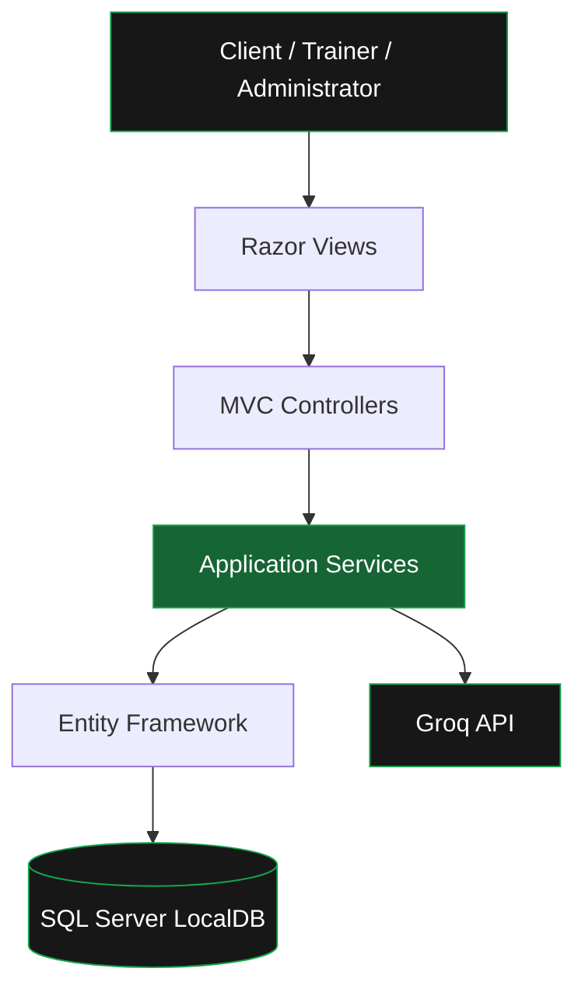

# HealthTrack Pro

<div align="center">

### A smarter way to manage health, fitness and progress.

**An integrated fitness management platform for clients, trainers and administrators.**

[](https://dotnet.microsoft.com/)
[](https://learn.microsoft.com/en-us/aspnet/mvc/)
[](https://learn.microsoft.com/en-us/dotnet/csharp/)
[](https://learn.microsoft.com/en-us/sql/)
[](https://groq.com/)

[Overview](#overview) · [Features](#features) · [Preview](#application-preview) · [Getting Started](#getting-started) · [Architecture](#architecture) · [Contributors](#contributors)

</div>

---

## Overview

**HealthTrack Pro** is a role-based health and fitness management application developed using ASP.NET MVC 5 and C#.

It brings fitness tracking, workout planning, nutrition management, trainer collaboration and progress monitoring into one unified platform.

Built around a clean green-and-black interface, HealthTrack Pro aims to make fitness management more organised, accessible and engaging.

### What makes it different?

- **One connected platform** for clients, trainers and administrators.
- **Data-driven progress tracking** with interactive charts and health measurements.
- **Personalised fitness management** through workout plans, diet plans and goals.
- **AI-powered assistance** using the Groq API.
- **Role-based workflows** supported by ASP.NET Identity.
- **Structured application architecture** using MVC, service interfaces and Entity Framework.

## Application Preview

### Client Dashboard

A personalised overview of health statistics, fitness goals and progress trends.


### Progress Analytics

Visualise changes in weight, BMI and other recorded health metrics.


### AI Fitness Coach

An integrated conversational assistant for general fitness guidance.


**Client Profile**


**Fitness Goals**


**Workout Management**


**Diet Management**


</details>

---

## Features

### Client Experience

| Feature | Description |
|---|---|
| Personal Dashboard | Centralised overview of fitness activity and health statistics |
| Health Tracking | Monitor weight, BMI and other recorded measurements |
| Fitness Goals | Create and track personal fitness targets |
| Workout Management | Access assigned workouts and record activity |
| Nutrition Management | Review diet plans and maintain meal records |
| Progress Analytics | Visualise health and fitness trends |
| Appointments | Schedule and manage trainer appointments |
| AI Fitness Coach | Receive conversational fitness guidance |
| Notifications | Stay informed about relevant activities |
| Profile Management | Maintain personal and health information |

### Trainer Workspace

- Manage assigned clients and their fitness information.
- Create and manage personalised workout plans.
- Organise diet plans and exercise programmes.
- Manage appointment requests and availability.
- Review client progress and provide feedback.
- Access relevant reports and notifications.

### Administration

- Manage users and trainer accounts.
- Maintain trainer–client assignments.
- Oversee appointments and system operations.
- Access administrative reports.
- Review audit logs.
- Manage supported system settings.

---

## Technology Stack

| Category | Technologies |
|---|---|
| Backend | C#, ASP.NET MVC 5, .NET Framework 4.8 |
| Frontend | Razor, HTML5, CSS3, JavaScript |
| Database | SQL Server LocalDB |
| Data Access | Entity Framework 6 |
| Authentication | ASP.NET Identity |
| AI Integration | Groq API |
| Development | Visual Studio |
| Version Control | Git, GitHub |

## Architecture

The application uses a layered MVC structure that separates user interfaces, request handling, business operations and persistence.



### Design Principles

**Separation of concerns:** Controllers, views, models and services have distinct responsibilities.

**Object-oriented design:** Classes and interfaces support modularity, encapsulation and maintainability.

**Role-based access:** Client, Trainer and Administrator areas provide differentiated workflows.

**Persistence:** Entity Framework manages application data using SQL Server.

---

## Getting Started

### Requirements

- Windows 10 or later
- Visual Studio with ASP.NET web development tools
- .NET Framework 4.8
- SQL Server Express LocalDB
- Git
- Internet access for dependencies and AI features

### 1. Clone the repository

```bash
git clone https://github.com/MaleeshaDewmina/HealthTrack-Pro.git
cd HealthTrack-Pro
```

### 2. Check out the final release

```bash
git checkout v1.0-coursework-final
```

### 3. Open the solution

Open `HealthTrackPro.sln` in Visual Studio.

Restore missing NuGet packages and set `HealthTrackPro.Web` as the startup project.

### 4. Configure the database

Open `HealthTrackPro.Web/Web.config` and configure the `DefaultConnection` connection string for your local SQL Server LocalDB instance.

Example:

```xml
<connectionStrings>
  <add
    name="DefaultConnection"
    connectionString="Data Source=(LocalDb)\MSSQLLocalDB;AttachDbFilename=|DataDirectory|\HealthTrackPro_Local.mdf;Initial Catalog=HealthTrackPro_Local;Integrated Security=True"
    providerName="System.Data.SqlClient" />
</connectionStrings>
```

Ensure the `App_Data` folder exists when using an attached database file.

Use a unique database name to avoid conflicts with other installations.

### 5. Apply database migrations

In Visual Studio, open **Tools → NuGet Package Manager → Package Manager Console**.

Set the default project to `HealthTrackPro.Web`, then execute:

```powershell
Update-Database -Verbose
```

Verify that migrations complete successfully and that the application roles are seeded.

### 6. Configure AI integration

HealthTrack Pro uses the `GROQ_API_KEY` environment variable.

On Windows, configure it as a user environment variable and restart Visual Studio.

Do not commit API credentials to source control.

### 7. Launch

Build the solution, then press **F5** to run the application through IIS Express.

Register a Client account to explore the Client module. Trainer and Administrator functionality requires the corresponding role assignments.

---

## AI Integration

The AI Coach connects the Client interface to the Groq API through the application's backend.

```text
Client
  ↓
AI Coach Interface
  ↓
Application Controller
  ↓
Service Layer
  ├── Conversation Persistence
  └── Groq API
         ↓
     AI Response
```

The AI Coach supports conversational fitness guidance and conversation management.

AI responses are informational and should not be treated as medical advice.

---

## Testing

HealthTrack Pro was developed with attention to functional correctness, integration and usability.

Key verification areas include:

- Authentication and role-based access.
- Client profile and fitness data management.
- Workout and diet workflows.
- Progress recording and visualisation.
- Trainer and administrator functionality.
- Appointment handling.
- AI Coach integration.
- Input validation and error handling.

Automated tests can be executed through Visual Studio Test Explorer where supported by the solution.

---

## Version Control

Development followed a feature-branch workflow with integration through the `develop` branch.

```text
Feature Development
        ↓
     develop
        ↓
       main
        ↓
v1.0-coursework-final
```

The final coursework release is identified by the tag:

**`v1.0-coursework-final`**

[View Repository](https://github.com/MaleeshaDewmina/HealthTrack-Pro) · [View Releases](https://github.com/MaleeshaDewmina/HealthTrack-Pro/releases)

---

## Contributors

HealthTrack Pro was developed collaboratively as part of an Application Development coursework project.

| Contributor | Responsibility |
|---|---|
| **Maleesha Dewmina** | Project leadership, backend integration, authentication and administration |
| **Chathura Denuwan** | Client module, fitness dashboards, progress interfaces and AI Coach experience |
| **Dinethi Ruvisha** | Trainer module and trainer-related management workflows |

### Development Approach

The team collaborated using Git branches, pull requests, code integration and testing to produce a unified application.

---

## Project Scope

This application was created for academic and demonstration purposes.

It demonstrates practical implementation of object-oriented programming, MVC architecture, relational data management, authentication, service-oriented application design and external API integration.

Further security, privacy, accessibility and performance assessment would be required before production deployment.

## License

No open-source license is granted by this README. Refer to the repository's `LICENSE` file, if present, for applicable permissions.

---

<div align="center">

**HEALTHTRACK PRO**

*Track progress. Build consistency. Achieve more.*

Developed with ASP.NET MVC, C# and SQL Server.

[Back to top](#healthtrack-pro)

</div>
